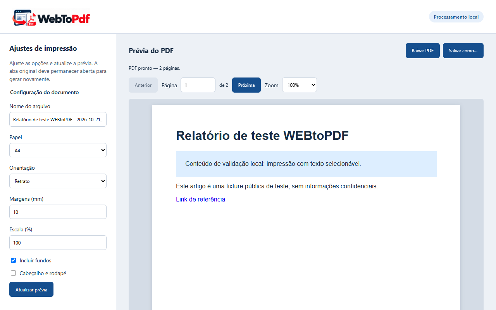

<p align="center">
  
</p>

<h1 align="center">WEBtoPDF</h1>

<p align="center">
  Converte a aba que você está vendo em PDF, PNG ou texto, com prévia antes de salvar.<br>
  Tudo acontece no seu computador — nada é enviado para servidores.
</p>

<p align="center">
  <sub>Versão 1.9.0 · <a href="CHANGELOG.md">novidades</a> · <a href="https://github.com/Mankeya/WebToPdf/releases/tag/v1.9.0">download</a></sub>
</p>

<p align="center">
  <a href="#instalação">Instalar</a> •
  <a href="#como-usar">Como usar</a> •
  <a href="#recursos">Recursos</a> •
  <a href="#novidades">Novidades</a> •
  <a href="#privacidade">Privacidade</a> •
  <a href="#desenvolvimento">Desenvolvimento</a>
</p>

<p align="center">
  
</p>

---

## O que é

Clicar no ícone do WEBtoPDF abre um **menu de formatos**. Escolher **PDF**, **PDF da tela**, **PNG** ou **Texto** abre a prévia da página atual, **já convertida**. Você revisa o resultado e só então salva o arquivo — no PDF dá para ajustar a impressão antes. Markdown chega na próxima versão — um formato por versão, cada um testado antes de entrar.

O PDF usa o motor de impressão do próprio Chrome: sai **paginado**, com **texto selecionável** e **links clicáveis**, respeitando o layout de impressão do site. O **PDF da tela** é diferente: ele embute uma captura da área visível como uma folha de imagem fiel ao que você está vendo — feito para páginas com menus que se fecham sozinhos quando você tira o foco.

## Recursos

| Recurso | Detalhe |
|---|---|
| **Menu de formatos** | Um clique no ícone abre o menu; PDF, PDF da tela, PNG e Texto já estão disponíveis e os próximos formatos chegam um por versão |
| **Conversão direta (opcional)** | Ligue no menu e o ícone passa a abrir o PDF direto, sem escolher formato; desligue na prévia |
| **PDF paginado** | Motor de impressão do Chrome, com texto selecionável e links clicáveis; o PDF é gerado no instante em que o menu abre, então menus abertos entram no documento — e o `Ctrl+Shift+P` gera o PDF sem abrir o menu |
| **PDF da tela** | A área visível vira uma folha de imagem fiel ao que está na tela — para páginas com menus que fecham sozinhos; o `Ctrl+Shift+S` captura sem passar pelo menu |
| **PNG da página inteira** | Captura a página toda com a aparência da tela, em uma única imagem |
| **Texto em `.txt`** | Só o texto visível da página, em UTF-8 com BOM, pronto para o Bloco do Windows |
| **Prévia imediata** | A aba atual já aparece convertida ao abrir a tela |
| **Página por página** | Navegação, campo de página e zoom de 50% a 200% |
| **Texto e links** | Camada de texto selecionável e links clicáveis |
| **Tamanhos de papel** | A4, A3, A5, Carta, Legal, Tabloid, sob medida e **página inteira** |
| **Página inteira** | Uma única folha contínua com a altura do conteúdo, sem paginação |
| **Ajustes de impressão** | Orientação, margens, escala, fundos e cabeçalho/rodapé |
| **Atualização sob demanda** | As alterações só entram no PDF ao clicar em **Atualizar prévia** |
| **Nome automático** | `Título da página - AAAA-MM-DD_HH-mm-ss.pdf` (ou `.png`, `.txt`), sanitizado para o Windows |
| **Nunca sobrescreve** | Nomes repetidos recebem sufixo, como `relatório (1).pdf` |
| **Duas formas de salvar** | **Baixar** na pasta do navegador e **Salvar como…** com o diálogo nativo |
| **Preferências lembradas** | Suas últimas opções de impressão sobrevivem ao reinício do navegador |
| **Modo claro/escuro** | Botão no cabeçalho da prévia; o tema fica salvo e o documento permanece branco |
| **Interface em português** | Toda a extensão, do botão ao mensaje de erro |
| **Janela anônima** | Funciona em modo split: nada do anônimo é persistido no perfil e o download sempre abre "Salvar como…" |

<!-- novidades -->

### v1.9.0 — 29/10/2026

- Funciona em janelas anônimas (Ctrl+Shift+N), com proteções extras: nada do anônimo fica salvo no perfil e todo download abre o diálogo Salvar como…

### v1.8.0 — 28/10/2026

- O PDF agora entra com o menu ainda aberto: a página é impressa no instante em que o menu abre, com a página em foco, e o arquivo sai com texto selecionável
- Novo atalho Ctrl+Shift+P: gera o PDF sem abrir o menu e já abre a prévia pronta — o caminho garantido para portais que fecham menus ao perder o foco

### v1.7.1 — 28/10/2026

- OCR do PDF da tela carrega sem erros de política do navegador e mantém o texto reconhecido mesmo com palavras contendo caracteres especiais

<!-- /novidades -->

## Instalação

> Requisito: **Chrome 116 ou superior**, no Windows.

1. Baixe o pacote da [página de releases](https://github.com/Mankeya/WebToPdf/releases).
2. Descompacte o `.zip`.
3. Abra `chrome://extensions`, ative o **Modo do desenvolvedor** e escolha **Carregar sem compactação**.
4. Selecione a pasta `webtopdf` extraída e fixe o ícone na barra de extensões.

**Para usar em janelas anônimas**: abra `chrome://extensions` → **Detalhes** do WEBtoPDF e ative **Permitir na navegação anônima** (em alguns navegadores já vem ligado). Sem esse interruptor, o Chrome não executa a extensão em janelas anônimas.

Para instalar sem modo desenvolvedor, é preciso publicar na Chrome Web Store. O material da publicação está em [`store/`](store/listing.md) e o guia de distribuição em [`docs/distribution.md`](docs/distribution.md).

## Como usar

1. Abra qualquer página HTTP ou HTTPS.
2. Clique no ícone **WEBtoPDF**.
3. No menu de formatos, escolha **PDF**, **PDF da tela**, **PNG** ou **Texto**. O formato que ainda não chegou aparece desabilitado, com o selo **Em breve**.
4. Uma nova aba abre com a prévia.
5. Em **PDF**, ajuste as opções de impressão e clique em **Atualizar prévia**, se quiser. Em **página inteira**, o PDF vira uma única folha contínua com a altura do conteúdo; sites que definem quebras de página no CSS de impressão continuam sendo divididos — o Chrome respeita a intenção do autor. Em **PDF da tela**, a prévia mostra a captura da área visível como folha de imagem, sem texto selecionável; o único ajuste é o nome do arquivo. Em **PNG**, a captura é sempre a página inteira e o único ajuste é o nome do arquivo. Em **Texto**, a prévia mostra o texto da página como ele está na tela e o único ajuste também é o nome do arquivo.
6. Clique em **Baixar PDF** (ou **Baixar PDF da tela**, **Baixar PNG**, **Baixar Texto**) ou **Salvar como…**.

### PDF da tela: para menus que fecham sozinhos

Alguns sites fecham menus e dropdowns no instante em que a página perde o foco — e o clique no ícone da extensão já rouba esse foco. O **PDF da tela** resolve isso do lado de dentro: no momento em que o menu abre, a extensão dispara uma captura da área visível, tentando registrar a tela antes do site limpar o menu. Depois é só escolher **PDF da tela** no menu e baixar a folha de imagem.

Dois pontos honestos:

- A captura é uma **corrida**: sites que fecham o menu instantaneamente no `blur` podem não deixar tempo. Para esses casos, o **`Ctrl+Shift+S`** é a forma garantida — ele captura a página **sem abrir o menu**, sem roubar foco, e já abre a prévia do PDF da tela.
- O PDF da tela é uma **imagem**: sai fiel ao que está na tela (fundos, temas escuros, menus), mas **sem texto selecionável e sem links clicáveis**. Quando precisar de texto, use o PDF normal.

### PDF com o menu aberto

O **PDF normal** também trata de menus que se fecham: no momento em que o menu de formatos abre, a extensão dispara a impressão da aba **com a página ainda em foco** e guarda o resultado em memória. Escolher **PDF** entrega esse arquivo — o menu que estava aberto entra no documento, com o texto original selecionável. O PDF guardado é de **uso único**: ajustar qualquer opção de impressão na prévia faz a conversão imprimir de novo, ao vivo.

Dois pontos honestos:

- A impressão antecipada é uma **corrida**, vencida na prática pelos portais reais (a captura antecipada do PDF da tela já registrava o menu aberto). Sites que fecham o menu no mesmo instante do `blur` podem perder a corrida — para esses, o **`Ctrl+Shift+P`** é a forma garantida: ele gera o PDF **sem abrir o menu**, sem roubar o foco da página, e abre a prévia pronta.
- A impressão antecipada usa as **configurações salvas**; a prévia pode ajustar tudo normalmente antes de baixar.

### Conversão direta em 1 clique (opcional)

No fim do menu, ative **Conversão direta em 1 clique**: da próxima vez, o ícone abre a prévia do PDF já convertida, sem mostrar o menu. O modo fica salvo; para voltar ao menu, desligue a opção **Conversão direta** na barra lateral da prévia. Páginas que não podem ser convertidas (`chrome://` etc.) abrem a prévia com o aviso.

A aba original precisa continuar aberta enquanto você ajusta e regenera o documento. Se ela for fechada, a prévia já pronta continua disponível para download.

### Janela anônima

Com **Permitir na navegação anônima** ativado nos detalhes da extensão, o WEBtoPDF funciona normalmente em janelas anônimas (`Ctrl+Shift+N`), com todas as regras de privacidade reforçadas:

- Ajustes feitos no anônimo valem **só para aquela janela** — nada é gravado no perfil normal.
- Todo download abre **"Salvar como…"**, para o arquivo cair onde você escolher.
- Ao fechar a janela anônima, tudo que existia nela (caches em memória incluídos) é descartado junto.

## Privacidade

O WEBtoPDF **não envia nada para fora do seu computador**.

- Sem servidores, sem conta, sem telemetria, sem publicidade, sem análise de uso.
- A extensão **não injeta scripts, HTML ou CSS** nas páginas e não altera o que você está vendo. De conteúdo do site, ela lê apenas o necessário para o formato escolhido: no PDF e no PNG o trabalho é todo do motor de impressão e do compositor do Chrome; no **Texto**, uma única leitura do texto visível na tela (`innerText`) da aba que você escolheu converter — que fica só na sua máquina.
- Sem acesso a cookies, histórico de navegação ou lista de permissões de sites.
- Os únicos dados guardados são as suas **preferências de impressão**, a opção de conversão direta e o tema (claro/escuro) da prévia, no perfil local do navegador.
- O documento convertido (PDF, imagem ou texto) fica **apenas na memória** da aba da prévia e é descartado ao fechar ou recarregar a aba.
- No **PDF da tela**, a captura antecipada fica **apenas na memória do service worker**, associada à aba e à URL, por no máximo **30 segundos** e no máximo quatro capturas — e é apagada ao navegar, fechar a aba ou expirar. Nada é gravado em disco, em `storage` ou enviado para fora.
- No **PDF**, a impressão antecipada segue as mesmas regras: fica **apenas na memória do service worker**, associada à aba, à URL e às configurações usadas, por no máximo **60 segundos**, de **uso único** (a primeira conversão a consome) e com teto de **32 MB** no total — apagada ao navegar, fechar a aba ou expirar. Nada é gravado em disco, em `storage` ou enviado para fora.
- Em **janelas anônimas**, a extensão roda em processo separado (modo split): preferências só são lidas, nunca gravadas, e todo download abre **"Salvar como…"** — fechar a janela apaga tudo.

A extensão pede quatro permissões, todas com uso restrito e verificável:

| Permissão | Para quê |
|---|---|
| `activeTab` | Ler URL e título da aba acionada (validação no menu e nome do arquivo) e capturar a área visível para o PDF da tela |
| `debugger` | Usar o motor de impressão, a captura de imagem e a leitura do texto visível do Chrome, sempre na aba que você escolheu |
| `storage` | Lembrar as preferências de impressão |
| `downloads` | Gravar o arquivo escolhido e evitar sobrescrita de arquivos |

Detalhes completos em [`docs/security.md`](docs/security.md) e [`SECURITY.md`](SECURITY.md).

## Limitações conhecidas

- O Chrome exibe um aviso temporário ao iniciar a impressão; ele desaparece quando a conversão termina.
- O DevTools aberto na aba original pode interromper a conversão.
- O layout de impressão do site pode diferir do que você vê na tela.
- Conteúdo que ainda não carregou por rolagem pode não aparecer.
- No **PDF da tela**, a captura antecipada disputa com o próprio site: páginas que fecham menus instantaneamente no `blur` podem capturar a tela já sem o menu. Use o atalho `Ctrl+Shift+S`, que captura sem roubar o foco da página.
- No **PDF**, a impressão antecipada disputa a mesma corrida: portais reais deixam o menu aberto tempo suficiente, mas um fechamento instantâneo no `blur` pode perder. Use o atalho `Ctrl+Shift+P`, que gera o PDF com a página em foco, sem abrir o menu.
- No **Texto**, só entra o que está visível na página renderizada: texto escondido, atributos e iframes inacessíveis ficam de fora — e uma página só de imagens é recusada com mensagem clara.
- Documentos acima de **32 MB** ou conversões acima de **60 segundos** são recusados com mensagem clara.
- A detecção de nomes repetidos usa o histórico de downloads do Chrome; arquivos baixados por outros meios não são detectados. Use **Salvar como…** quando precisar de garantia.

## Desenvolvimento

```bash
npm ci            # instala as dependências fixadas no lockfile
npm run dev       # gera a extensão continuamente em dist/
npm run check     # tipos, testes unitários e build
npm run test:e2e  # testes de fluxo real em Chromium
```

| Script | O que faz |
|---|---|
| `npm run dev` | Build contínuo em `dist/` |
| `npm run build` | Gera a extensão em `dist/` |
| `npm run package` | Gera `webtopdf-<versão>.zip` |
| `npm run package:store` | Gera o pacote sem minificação, para a Chrome Web Store |
| `npm run publish:store` | Envia o pacote à loja e submete à revisão |
| `npm run test` | Testes unitários (Vitest) |
| `npm run test:e2e` | Testes de ponta a ponta com a extensão real (Playwright) |
| `npm run typecheck` | Verificação de tipos |
| `npm run icons` | Regenera os ícones a partir da marca |
| `npm run brand:extract` | Extrai as peças de marca da folha oficial |
| `npm run store:screenshots` | Gera as capturas para a Chrome Web Store |
| `npm run verify:manifest` | Confere permissões, CSP e versão do manifesto |
| `npm run verify:workspace` | Garante que não há artefatos órfãos na raiz |
| `npm run release:prepare` | Sobe a versão e fecha CHANGELOG e README para o próximo merge |
| `npm run release:check` | Confere se a release está pronta (o CI usa o mesmo script) |

### Estrutura

```text
src/background/     Conversão via chrome.debugger e validação no service worker
src/popup/          Menu de formatos aberto pelo ícone
src/preview/        Prévia, ajustes, download e visualização com PDF.js
src/shared/         Configurações, formatos, nomes de arquivo e contratos
src/styles/         Tokens da marca compartilhados entre telas
public/             Manifesto MV3, ícones e marca
scripts/            Ícones, empacotamento, capturas e verificações
tests/unit/         Testes de regras puras
tests/e2e/          Testes de fluxo real
docs/               Especificação, arquitetura, segurança e validação
```

### Documentação

| Documento | Conteúdo |
|---|---|
| [`docs/specification.md`](docs/specification.md) | Escopo aprovado e critérios de aceitação |
| [`docs/architecture.md`](docs/architecture.md) | Decisões técnicas e Trade-offs |
| [`docs/security.md`](docs/security.md) | Permissões, CSP, riscos residuais |
| [`docs/validation.md`](docs/validation.md) | O que é validado e como |
| [`docs/production-checklist.md`](docs/production-checklist.md) | Checklist manual de aceitação |
| [`docs/distribution.md`](docs/distribution.md) | Caminhos de distribuição |
| [`CHANGELOG.md`](CHANGELOG.md) | Histórico de versões |

## Contribuição

Branches curtas, commits convencionais e integração por PR. A branch principal é protegida: toda mudança passa pelos checks de integração contínua.

**Cada merge publica uma versão.** Antes de abrir o PR, prepare a release:

```bash
npm run release:prepare -- minor -- "o que mudou para o usuário"
```

O incremento segue o commit convencional: `feat` → minor, `fix` → patch, mudança incompatível → major. O CI bloqueia o merge se a versão, o CHANGELOG ou o README não estiverem prontos; ao integrar, a tag e a release são publicadas automaticamente com o `.zip`.

```bash
git switch -c feat/minha-mudanca
# ... código, testes e documentação
npm run release:prepare -- minor -- "destaque da mudança"
git commit -m "feat: descrição da mudança"
git push -u origin feat/minha-mudanca
```

Abra o PR pelo link exibido após o push. O modelo de pull request está em [`.github/pull_request_template.md`](.github/pull_request_template.md).

## Licença

Este repositório ainda não tem uma licença definida. A escolha é do responsável pelo projeto e precisa ser tomada antes de qualquer distribuição pública.

---

<p align="center">
  Feito com o motor de impressão do Chrome. <strong>Processamento 100% local.</strong>
</p>
